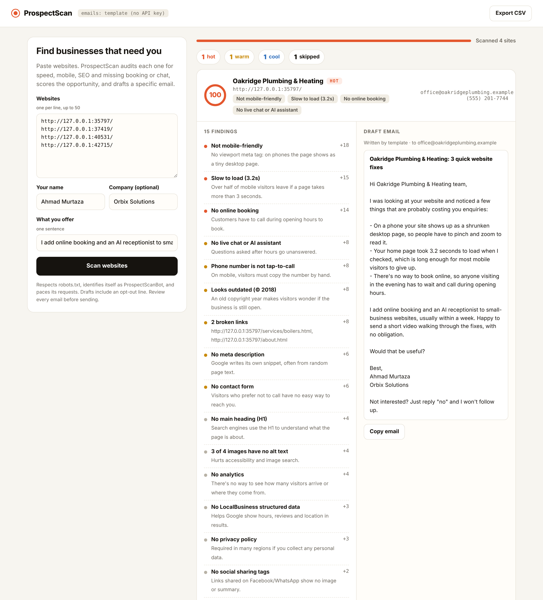

# ProspectScan

**Website audits that find your next client, and write the first email for you.**

Give ProspectScan a list of small-business websites. For each one it:
1. Checks speed, mobile-friendliness, SEO, online booking, live chat, tap-to-call, broken links and how outdated the site looks.
2. Scores the sales opportunity from 0 to 100.
3. Drafts a short, specific cold email that mentions the real problems it found.



It's built for freelancers and agencies who sell web, booking or AI-assistant services. A slow, non-mobile site with no online booking is a hot lead. A modern site with Calendly and live chat isn't worth emailing.

```
$ prospectscan audit oakridgeplumbing.com harboryoga.com brightsmile.com sunsetbistro.com -o prospects.csv

HOT   100/100  Oakridge Plumbing & Heating
        · Not mobile-friendly
        · Slow to load (3.2s)
        · No online booking
        · No live chat or AI assistant
        · Phone number is not tap-to-call
        ✉ office@oakridgeplumbing.example

WARM   37/100  Harbor Yoga Studio
        · No online booking
        · Could be faster (1.8s)
        · No live chat or AI assistant
        ✉ hello@harboryoga.example

COOL    0/100  Bright Smile Dental
        ✉ hello@brightsmile.example

- sunsetbistro.com  skipped: robots.txt asks bots not to crawl this site

Done: 4 sites, 1 hot prospect.
```
*This is real output from the fictional fixture sites in `fixtures/sites/`; the domains are shortened for readability.*

## What it checks

| Area | Checks |
|---|---|
| Speed | Home page load time, number of external scripts |
| Mobile | Viewport meta tag (does it render properly on phones?) |
| SEO | Title, meta description, H1, image alt text, LocalBusiness structured data, social sharing tags |
| Conversion | Online booking (Calendly, Acuity, Square, Zocdoc, Mindbody…), live chat (Intercom, Tidio, Crisp, tawk.to, WhatsApp…), tap-to-call link, contact form, visible email, analytics |
| Trust | HTTPS, privacy policy, broken internal links (sampled) |
| Freshness | Outdated copyright year |
| Platform | WordPress, Wix, Squarespace, Shopify, Webflow… (for context) |

Each finding carries points, and the points add up to the opportunity score:
- **Hot:** 60 or more.
- **Warm:** 35–59.
- **Cool:** below 35.

Contact emails and phone numbers are collected from the home page and the contact page.

## Outreach emails

- **With an `ANTHROPIC_API_KEY`:** Claude writes each email. The rules: under 120 words, use only the audit's facts, no hype, and finish with an opt-out line.
- **Without a key:** a deterministic template builds the email from each finding's prewritten "pitch" sentence. For example: *"your home page took 3.2 seconds to load when I checked, which is long enough for most mobile visitors to give up."*

Either way, review every email before sending.

## Responsible by design

- **Respects `robots.txt`:** honours User-agent groups, Allow/Disallow, and `*` / `$` patterns.
- **Identifies itself** as `ProspectScanBot/1.0` with a link back to this repo.
- **Paces requests:** a delay between requests to the same site, and a limit on concurrent sites.
- **SSRF protection:** private, loopback, link-local and internal addresses are refused by default, so a public deployment can't be used to probe internal networks. `ALLOW_PRIVATE_NETWORKS=true` turns this off for local testing only.
- **Emails include an opt-out line.** Follow the cold-email laws where you send (CAN-SPAM, GDPR/PECR).

## Tech stack

| Layer | Tools |
|---|---|
| Runtime | Node.js 20+, TypeScript (strict, ESM) |
| Crawling and parsing | native `fetch`, cheerio, custom robots.txt parser |
| API and dashboard | Express, zod validation, in-memory job queue with p-limit concurrency, vanilla JS front end |
| CLI | commander, CSV and JSON export |
| AI | Anthropic Claude (optional) |
| Quality | Vitest (36 tests against local fixture websites), supertest, GitHub Actions on Node 20 and 22, multi-stage Docker build |

## Quick start

```bash
git clone https://github.com/ahmad0187/prospectscan-Node.js.git
cd prospectscan-Node.js
npm install
npm run demo
```

`npm run demo` serves four fictional business websites on localhost, starts the dashboard, and prints the URLs to paste in.

**Audit real sites from the CLI:**
```bash
npm run cli -- audit example.com another-business.com -o prospects.csv --sender "Your Name" --offer "I build fast, mobile-friendly sites with online booking"
npm run cli -- audit --file leads.csv --json results.json      # first column = URL
```

**Run the dashboard:**
```bash
cp .env.example .env     # optional: ANTHROPIC_API_KEY
npm run dev              # http://localhost:3000
```

**Docker:**
```bash
docker build -t prospectscan .
docker run -p 3000:3000 -e ANTHROPIC_API_KEY=your-key prospectscan
```

**Tests:**
```bash
npm test
npm run typecheck
```

## API

| Method | Endpoint | Description |
|---|---|---|
| `POST` | `/api/audits` | `{ urls: string[] (max 50), senderName, senderCompany?, offer }` → `202 { id }` |
| `GET` | `/api/audits/:id` | Job status, progress, and per-site results with drafted emails |
| `GET` | `/api/audits/:id/export.csv` | CSV with score, grade, contacts, top findings and the email |
| `GET` | `/api/health` | Shows which email writer is active |

## Project structure

```
src/
  audit/
    audit.ts       Orchestrates one site: SSRF guard → robots.txt → home → contact page → link sample → checks
    fetchPage.ts   Timed fetch with timeout, size cap and bot user agent
    parse.ts       cheerio → page facts (meta, links, emails, phones, forms…)
    detect.ts      Booking / chat / analytics / platform signatures
    checks.ts      Facts → scored findings, grade
    robots.ts      robots.txt parser
    netguard.ts    Private-address (SSRF) guard
  outreach/email.ts  Claude or template email writer
  jobs.ts          In-memory job queue (swap for BullMQ + Redis to scale)
  server.ts        Express API + dashboard
  cli.ts           Command-line interface
fixtures/sites/    Four fictional websites used by the tests and the demo
test/              Unit and integration tests
```

## Roadmap ideas

- Google Places search to find businesses by niche and city.
- Send emails with follow-up sequences, and stop them on reply.
- Store jobs in Postgres and add per-user accounts.

## License

MIT. Built by [Ahmad Murtaza](https://github.com/ahmad0187).
